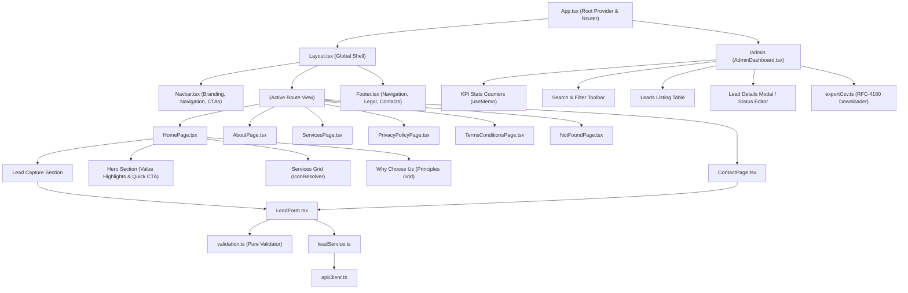
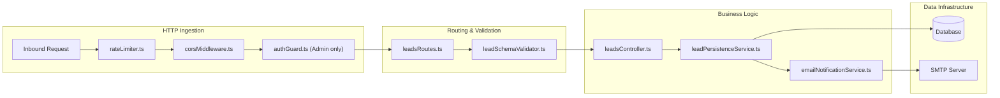
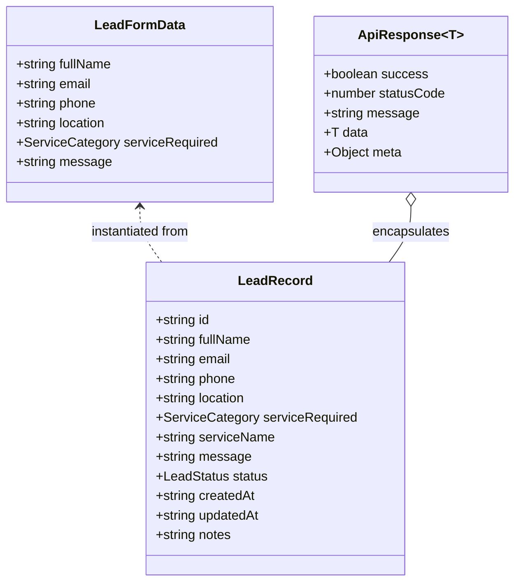
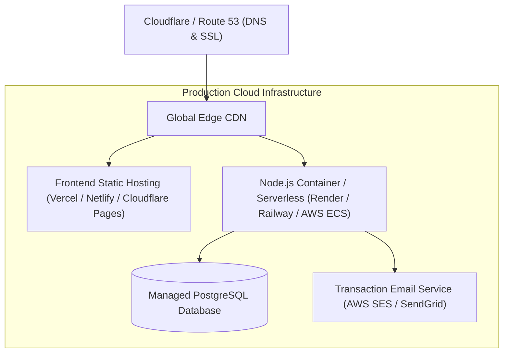

# System Architecture & Technical Specifications

This document provides a comprehensive blueprint of the Lead Generation Platform, detailing the implemented frontend architecture, the proposed backend service architecture, data flow diagrams, security controls, and integration boundaries.

---

## 1. Overall System Architecture

The application is structured as a decoupled client-server architecture:
- **Phase 1 (Implemented):** A high-performance, single-page frontend application built with React, TypeScript, and Tailwind CSS.
- **Phase 2 (Proposed):** A secure Node.js REST API service managing persistent storage, authentication, and email notifications.

```mermaid
flowchart TB
    subgraph ClientLayer["Frontend Application (Implemented - Phase 1)"]
        Browser["User Browser / Mobile Device"]
        Router["React Router DOM (App.tsx)"]
        PublicPages["Public Pages (Home, About, Services, Contact, Legal)"]
        LeadFormComponent["LeadForm Component (Validation & State)"]
        AdminPortal["Admin Dashboard (Leads Table & CSV Exporter)"]
        ServiceLayer["leadService.ts / apiClient.ts"]
    end

    subgraph Boundary["API & Integration Boundary"]
        HTTPGateway["HTTPS REST Endpoints (/api/leads)"]
        EnvConfig["VITE_API_BASE_URL (Configurable)"]
    end

    subgraph ServerLayer["Backend Infrastructure (Proposed - Phase 2)"]
        APIServer["Node.js / Express Server"]
        AuthMiddleware["JWT / Session Auth Guard"]
        ValidationMiddleware["Schema Validators (Zod/Joi)"]
        Controllers["Leads Controller"]
        DomainServices["Persistence & Notification Services"]
        Database[("Relational / Document DB (PostgreSQL / Mongo)")]
        SMTP["SMTP Email Service (Notification Dispatch)"]
    end

    Browser --> Router
    Router --> PublicPages
    Router --> AdminPortal
    PublicPages --> LeadFormComponent
    LeadFormComponent --> ServiceLayer
    AdminPortal --> ServiceLayer

    ServiceLayer -.->|HTTP JSON (Ready)| HTTPGateway
    HTTPGateway --> APIServer
    APIServer --> AuthMiddleware
    APIServer --> ValidationMiddleware
    ValidationMiddleware --> Controllers
    Controllers --> DomainServices
    DomainServices --> Database
    DomainServices --> SMTP

    classDef implemented fill:#e0effe,stroke:#026aa7,stroke-width:2px;
    classDef proposed fill:#fef3c7,stroke:#d97706,stroke-width:2px,stroke-dasharray: 5 5;
    class Browser,Router,PublicPages,LeadFormComponent,AdminPortal,ServiceLayer,Boundary,HTTPGateway,EnvConfig implemented;
    class APIServer,AuthMiddleware,ValidationMiddleware,Controllers,DomainServices,Database,SMTP proposed;
```

---

## 2. Frontend Architecture & Component Hierarchy

The frontend follows modular component principles, separating visual presentation, state management, form validation, and data transport into distinct layers.



---

## 3. Form Submission & Error Handling Workflow

The frontend lead enquiry form guarantees strict validation, preventing invalid network traffic while providing comprehensive feedback on backend availability.

```mermaid
sequenceDiagram
    autonumber
    actor User as Prospective Client
    participant Form as LeadForm.tsx
    participant Validator as validation.ts
    participant Service as leadService.ts
    participant Client as apiClient.ts
    participant Backend as Backend Server (Phase 2)

    User->>Form: Enters Name, Email, Phone, Location, Service, Message
    User->>Form: Clicks "Submit Free Quote Request"
    Form->>Validator: validateLeadForm(formData)
    
    alt Validation Fails
        Validator-->>Form: Returns Field Errors (e.g. invalid phone/email)
        Form->>User: Displays red inline error labels & shifts focus to 1st invalid input
    else Validation Passes
        Form->>Form: Sets isSubmitting=true (Disables inputs & shows spinner)
        Form->>Service: submitLead(formData)
        Service->>Client: apiRequest('POST', '/leads', formData)
        
        alt Backend is Offline (Phase 1 Status)
            Client-->>Service: Throws ApiConnectionError (Backend Offline)
            Service-->>Form: Returns { success: false, isBackendUnavailable: true }
            Form->>User: Renders amber "Backend API Offline" notification banner
            Form->>User: Offers "Inspect Validated API Payload" inspector
            Note over Form,User: No lead saved; no fake success displayed.
        else Backend Responds with Error (e.g. 400 Bad Request)
            Backend-->>Client: Returns 400 JSON { message, errors }
            Client-->>Service: Throws ApiConnectionError with server message
            Service-->>Form: Returns { success: false, message: 'Server validation error' }
            Form->>User: Displays error notification
        else Backend Responds with 201 Created
            Backend-->>Client: Returns 201 JSON { success: true, data: LeadRecord }
            Client-->>Service: Resolves successfully
            Service-->>Form: Returns { success: true, data: LeadRecord }
            Form->>User: Renders green "Enquiry Received Successfully" confirmation card
        end
    end
```

---

## 4. Routing Structure & Deep Linking

| Route Path | View Component | Access | Deep Link Anchors / Query Parameters |
| :--- | :--- | :--- | :--- |
| `/` | `HomePage` | Public | `#lead-capture` (Scrolls smoothly to hero quote form) |
| `/about` | `AboutPage` | Public | Standard page navigation |
| `/services` | `ServicesPage` | Public | `#consulting`, `#managed_services`, `#enterprise_solutions`, `#digital_transformation`, `#custom_development`, `#other` |
| `/contact` | `ContactPage` | Public | `#quote` (Lead Form anchor), `?service=<category>` (Pre-selects service) |
| `/privacy-policy` | `PrivacyPolicyPage` | Public | Standard legal route |
| `/terms-and-conditions` | `TermsConditionsPage` | Public | Standard legal route |
| `/admin` | `AdminDashboard` | Preview | In-memory filtering and CSV export |
| `*` | `NotFoundPage` | Public | Catches undefined paths; provides return navigation |

---

## 5. Proposed Backend Architecture (Phase 2 Planning Only)

The proposed backend is architected around a layered, modular pattern:

```text
backend/
├── src/
│   ├── config/          # Environment configuration & DB pool initialization
│   ├── controllers/     # HTTP endpoint handlers (leadsController.ts)
│   ├── routes/          # Express route mounting (leadsRoutes.ts)
│   ├── models/          # Database schema / ORM models (lead.model.ts)
│   ├── middleware/      # Auth guards, CORS, rate limiting, error handler
│   ├── services/        # Business logic (leadPersistence, notification)
│   ├── validators/      # Request schema validators (Zod / Joi)
│   └── utils/           # Shared response helpers & CSV formatters
├── tests/               # Test suites (unit & integration)
├── .env.example         # Backend environment blueprint
├── API_CONTRACTS.md     # Official REST schema contracts
└── README.md            # Backend developer guide
```

### Proposed Component Responsibilities



---

## 6. API Contracts Summary

All endpoint contracts are documented in detail in [`backend/API_CONTRACTS.md`](./backend/API_CONTRACTS.md).



---

## 7. Security & Compliance Architecture

### Frontend Security Controls (Phase 1 Implemented):
1. **Input Sanitization:** Strips leading/trailing whitespace, prevents script injection in textareas, and limits payload lengths (max 2,000 characters).
2. **Environment Variable Protection:** Secrets are never bundled into the client bundle; only explicitly declared `VITE_*` public variables are exposed.
3. **Admin Route Separation:** The `/admin` path is separated from public marketing navigation and flagged with `Disallow: /admin` in `robots.txt` and `noIndex={true}` in `<SEOHead>`.
4. **Accessible Error Handling:** Form errors do not leak stack traces or raw technical outputs to end users.

### Backend Security Requirements (Phase 2 Roadmap):
1. **Rate Limiting:** Protect `POST /api/leads` against spam flooding using an IP-based sliding window rate limiter (e.g. 10 requests / hour / IP).
2. **CORS Hardening:** Restrict allowed origins in production strictly to the finalized client domain.
3. **Session Security:** Use HTTP-only, secure, `SameSite=Strict` cookies or short-lived JWT bearer tokens for administrative endpoints.
4. **GDPR / Privacy Compliance:** Encrypt personal data at rest in the database; implement statutory deletion/retention mechanisms.

---

## 8. Future Deployment Architecture

When the client provides production domain and cloud hosting credentials in Phase 2, the recommended deployment topology is:


